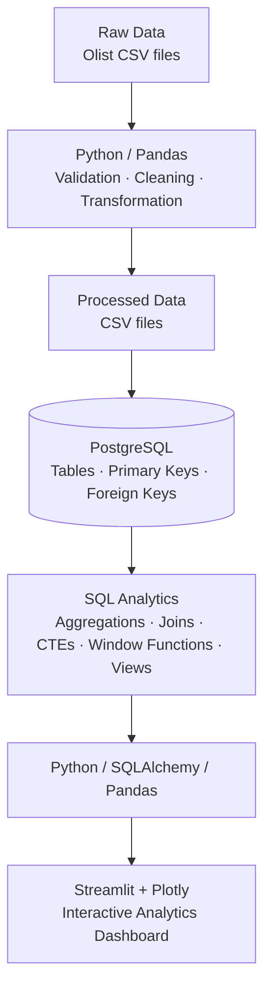

# End-to-End Data Pipeline and Analytics Platform

An end-to-end data engineering and analytics project built using the **Brazilian Olist E-Commerce Dataset**. The project transforms raw CSV datasets into structured PostgreSQL tables, performs SQL-based business analytics, and presents insights through an interactive Streamlit dashboard.

The platform uses **Python, Pandas, PostgreSQL, SQLAlchemy, Docker, Docker Compose, Streamlit, and Plotly**.

## Table of Contents

- [Project Overview](#project-overview)
- [Architecture](#architecture)
- [Technologies Used](#technologies-used)
- [Dataset](#dataset)
- [Project Structure](#project-structure)
- [Data Pipeline](#data-pipeline)
- [Database Design](#database-design)
- [SQL Analytics](#sql-analytics)
- [SQL Views](#sql-views)
- [Interactive Dashboard](#interactive-dashboard)
- [Running the Project with Docker](#running-the-project-with-docker)
- [Results](#results)
- [Future Improvements](#future-improvements)
- [Key Learning Outcomes](#key-learning-outcomes)
- [Author](#author)

## Project Overview

The goal of this project is to build a complete data workflow, from raw data ingestion to business intelligence.

The pipeline processes e-commerce data to analyze:

- Sales performance and revenue trends.
- Product category performance.
- Customer purchasing behavior.
- Payment methods and installment patterns.
- Order delivery performance.
- Customer reviews and satisfaction.

## Architecture



Docker and Docker Compose provide the containerized environment for the Python application and PostgreSQL database.

## Technologies Used

| Technology | Purpose |
| --- | --- |
| Python 3.12 | Main programming language |
| Pandas | Data ingestion, cleaning, transformation and manipulation |
| PostgreSQL 17 | Relational database |
| SQL | Data analysis and business queries |
| SQLAlchemy | Database engine and connection management |
| Psycopg | PostgreSQL database driver |
| Docker | Application containerization |
| Docker Compose | Multi-container orchestration |
| Streamlit | Interactive dashboard |
| Plotly | Data visualization |
| python-dotenv | Environment variable management |
| Pytest | Testing dependency |

## Dataset

The project uses the [Brazilian E-Commerce Public Dataset by Olist](https://www.kaggle.com/datasets/olistbr/brazilian-ecommerce), available on Kaggle.

The dataset contains information about orders, customers, products, sellers, payments, reviews, and geographical locations.

The pipeline processes nine source datasets:

| Dataset | Description |
| --- | --- |
| Orders | Order information and timestamps |
| Customers | Customer records and locations |
| Order Items | Products included in each order |
| Products | Product details and categories |
| Payments | Payment methods and values |
| Sellers | Seller information |
| Reviews | Customer reviews and scores |
| Geolocation | Brazilian geographical information |
| Category Translation | Portuguese-to-English category translations |

## Project Structure

```text
end-to-end-data-platform/
│
├── data/
│   ├── raw/
│   │   └── Original CSV datasets
│   │
│   └── processed/
│       └── Cleaned and transformed CSV files
│
├── src/
│   ├── ingestion/
│   │   └── CSV loading logic
│   │
│   ├── validation/
│   │   └── checks.py
│   │
│   ├── transformations/
│   │   ├── __init__.py
│   │   ├── cleaning.py
│   │   └── transform.py
│   │
│   ├── database/
│   │   ├── __init__.py
│   │   ├── connection.py
│   │   ├── load.py
│   │   └── test_connection.py
│   │
│   ├── dashboard/
│   │   └── app.py
│   │
│   └── main.py
│
├── sql/
│   ├── schema.sql
│   ├── analytics.sql
│   └── views.sql
│
├── Dockerfile
├── docker-compose.yml
├── .dockerignore
├── .env.example
├── .gitignore
├── requirements.txt
└── README.md
```

## Data Pipeline

### 1. Data Ingestion

The pipeline reads the original Olist CSV files using Pandas.

The raw datasets are stored in:

```text
data/raw/
```

The original source files are kept separate from the processed datasets.

### 2. Data Validation

Validation checks help identify data quality issues before transformation.

The checks include:

- Duplicate row detection.
- Duplicate column detection.
- Missing value analysis.
- Primary and composite identifier uniqueness.
- Referential integrity checks between datasets.
- Order status distribution.
- Date validity and chronological consistency.
- Invalid numerical values.

### 3. Data Cleaning

The cleaning stage prepares datasets for analysis.

Examples include:

- Standardizing column names.
- Converting date columns into datetime values.
- Handling malformed timestamps.
- Preserving valid missing values.
- Cleaning and standardizing dataset structures.

Invalid non-null date values are detected rather than silently accepted.

### 4. Data Transformation

Additional analytical features are created during transformation.

Examples include:

**Orders**

- Delivery time in days.
- Delivery delay in days.
- Purchase year.
- Purchase month.
- Purchase day.
- Purchase hour.

**Order Items**

- Item total, calculated as product price plus freight value.

**Reviews**

- Review year.
- Review month.

The cleaned and transformed datasets are exported to:

```text
data/processed/
```

### 5. Database Loading

The processed datasets are loaded into PostgreSQL using Pandas and SQLAlchemy.

The loader follows a dependency-aware loading order to respect foreign-key constraints.

The current implementation uses a **full-refresh loading strategy**: existing table records are cleared before the processed datasets are reloaded.

## Database Design

The PostgreSQL database is named:

```text
olist_analytics
```

It contains the following relational tables:

| Table | Primary Key |
| --- | --- |
| customers | customer_id |
| sellers | seller_id |
| products | product_id |
| orders | order_id |
| order_items | order_id, order_item_id |
| payments | order_id, payment_sequential |
| reviews | review_record_id |
| category_translation | product_category_name |

The database uses:

- Primary keys to identify records.
- Foreign keys to enforce relationships.
- Composite primary keys where a single column is not unique.
- Appropriate data types for dates, numerical values and identifiers.
- Indexes on selected relationship columns.

A surrogate primary key is used for reviews because the source `review_id` field is not unique across all records.

## SQL Analytics

The project includes SQL queries covering different business areas.

### Sales Performance

- Total delivered orders.
- Total revenue.
- Average order value (AOV).
- Monthly and yearly revenue.
- Month-over-month revenue growth.
- Cumulative revenue.

### Product Performance

- Revenue by product category.
- Top-selling products.
- Top products by revenue within each category.
- Average product price and freight cost.

### Customer Analytics

- Customer spending.
- Repeat customer analysis.
- Top customers by spending.
- Revenue by customer state.

### Payment Analytics

- Payment method distribution.
- Payment values by payment type.
- Installment analysis.

### Delivery Performance

- Average delivery time.
- Late delivery statistics.
- Delivery delay by customer state.

### Customer Reviews

- Review score distribution.
- Average review score by category.
- Relationship between delivery performance and review scores.

The SQL analysis uses:

- JOINs.
- GROUP BY and aggregate functions.
- Common Table Expressions (CTEs).
- Subqueries.
- Window functions such as LAG and ranking functions.

## SQL Views

Reusable analytical views are created to simplify database access from the dashboard.

| View | Purpose |
| --- | --- |
| `kpi_overview` | Overall business KPIs |
| `monthly_revenue` | Monthly sales performance |
| `category_revenue` | Revenue by product category |
| `customer_metrics` | Customer spending and order metrics |
| `delivery_performance` | Delivery performance indicators |
| `payment_analysis` | Payment method analysis |

These views centralize analytical logic in PostgreSQL rather than duplicating complex SQL queries throughout the Python application.

## Interactive Dashboard

The dashboard is built with Streamlit and Plotly.

It connects directly to PostgreSQL using SQLAlchemy and retrieves analytical results into Pandas DataFrames.

The dashboard provides:

- Overall business KPIs.
- Monthly revenue trends.
- Revenue by product category.
- Customer analytics.
- Delivery performance indicators.
- Payment method analysis.
- Interactive date-range filtering.
- Interactive charts and visualizations.

Streamlit caching is used to reuse the database engine and temporarily cache query results.

## Running the Project with Docker

### Prerequisites

Make sure you have installed:

- Docker Engine
- Docker Compose
- Git

> **Note:** On Linux, you may need to prefix `docker` commands with `sudo` unless your user is in the `docker` group.

### 1. Clone the repository

```bash
git clone https://github.com/YOUR_USERNAME/end-to-end-data-platform.git

cd end-to-end-data-platform
```

### 2. Add the raw datasets

Download the Olist dataset from Kaggle and place the required CSV files inside:

```text
data/raw/
```

### 3. Configure environment variables

Create a `.env` file in the project root:

```env
DB_HOST=db
DB_PORT=5432
DB_NAME=olist_analytics
DB_USER=olist_user
DB_PASSWORD=change_this_password
```

An example configuration is provided in `.env.example`.

**Important:** Never commit your real `.env` file or database credentials to GitHub.

### 4. Build the Docker image

```bash
docker compose build
```

### 5. Start the services

```bash
docker compose up -d
```

Check the container status:

```bash
docker compose ps
```

The application and PostgreSQL services should be running.

### 6. Run the ETL pipeline

```bash
docker compose exec app python src/main.py
```

This command reads the raw datasets, performs cleaning and transformation, and exports the processed CSV files.

### 7. Create the PostgreSQL schema

```bash
docker compose exec -T db psql \
  -U olist_user \
  -d olist_analytics \
  < sql/schema.sql
```

### 8. Load the processed datasets

```bash
docker compose exec app python src/database/load.py
```

### 9. Execute the analytical queries

```bash
docker compose exec -T db psql \
  -U olist_user \
  -d olist_analytics \
  < sql/analytics.sql
```

### 10. Create the analytical views

```bash
docker compose exec -T db psql \
  -U olist_user \
  -d olist_analytics \
  < sql/views.sql
```

### 11. Run the Streamlit dashboard

```bash
docker compose exec app streamlit run \
  src/dashboard/app.py \
  --server.address=0.0.0.0 \
  --server.port=8501
```

Open the dashboard in your browser:

```text
http://localhost:8501
```

### Useful Docker commands

```bash
# View running services
docker compose ps

# View application logs
docker compose logs app

# View database logs
docker compose logs db

# Access PostgreSQL
docker compose exec db psql \
  -U olist_user \
  -d olist_analytics

# Stop services
docker compose down

# Stop services and remove named volumes
# WARNING: this also deletes the persisted database volume
docker compose down -v
```

## Results

The completed pipeline successfully processes and loads the following datasets:

| Dataset | Processed Rows |
| --- | --- |
| Customers | 99,441 |
| Sellers | 3,095 |
| Products | 32,951 |
| Orders | 99,441 |
| Order Items | 112,650 |
| Payments | 103,886 |
| Reviews | 99,224 |
| Category Translations | 71 |

The database contains the processed relational datasets and reusable analytical views.

The dashboard provides a visual interface for exploring sales, customers, products, payments and delivery performance.

## Future Improvements

Potential extensions to the project include:

- Implement incremental data loading instead of full refreshes.
- Add automated unit and integration tests using Pytest.
- Add structured logging and error handling.
- Automate pipeline execution using cron or Apache Airflow.
- Integrate data ingestion from public APIs.
- Add monitoring and data quality reporting.
- Optimize database queries and indexes.
- Improve dashboard filtering and analytical capabilities.
- Add CI/CD and automated deployment.

## Key Learning Outcomes

Through this project, I gained practical experience with:

- Building an ETL pipeline using Python and Pandas.
- Data validation, cleaning and feature engineering.
- Relational database design and referential integrity.
- PostgreSQL and analytical SQL.
- Python database integration using SQLAlchemy and Psycopg.
- Docker containerization and Docker Compose.
- SQL views and reusable analytical logic.
- Interactive dashboards using Streamlit and Plotly.
- Designing an end-to-end data workflow.

## Author

**Anouar Semmid**

Data Science Student | Aspiring AI Engineer & Data Engineer

GitHub: [github.com/YOUR_USERNAME](https://github.com/YOUR_USERNAME)

---

**Disclaimer:** This project is an educational and portfolio project built using the public Olist dataset. Revenue and business metrics are analytical estimates derived from the available dataset and should not be interpreted as audited financial results.
